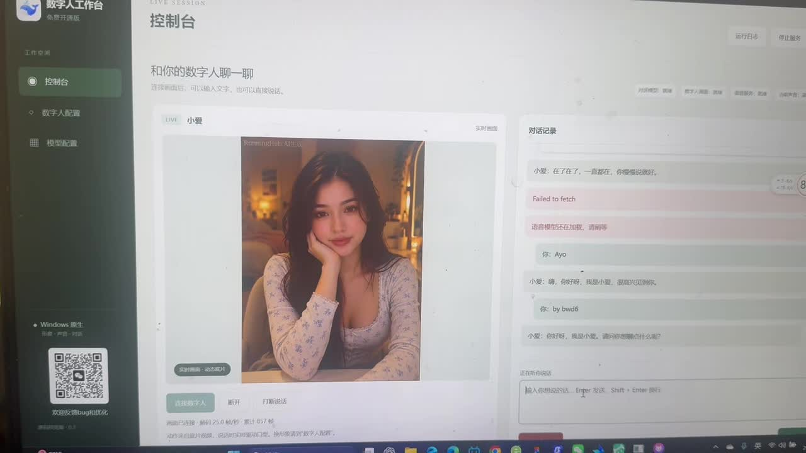
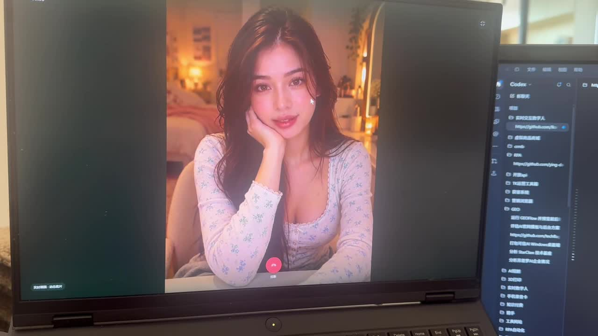
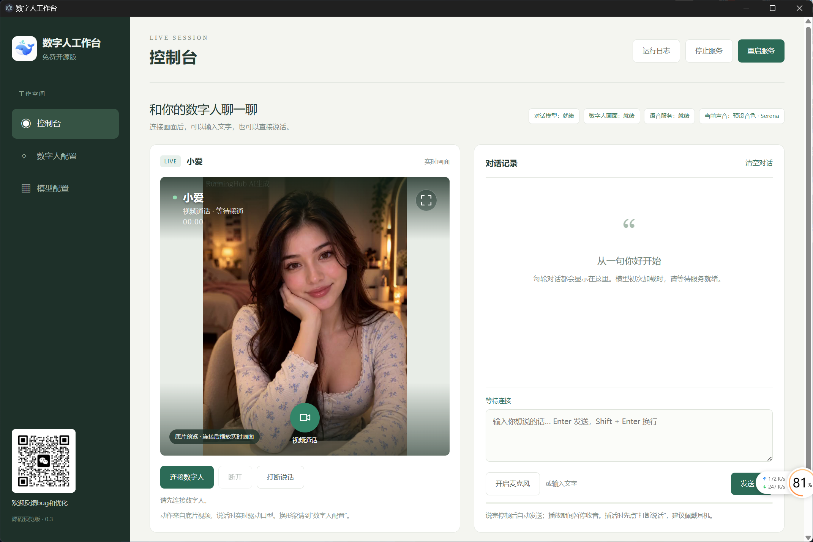
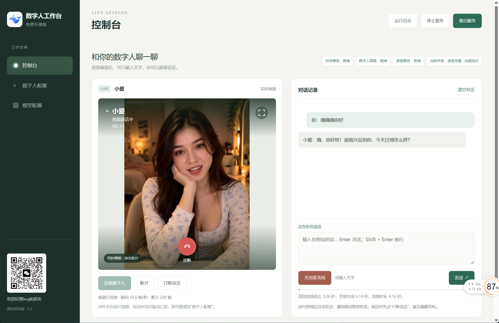
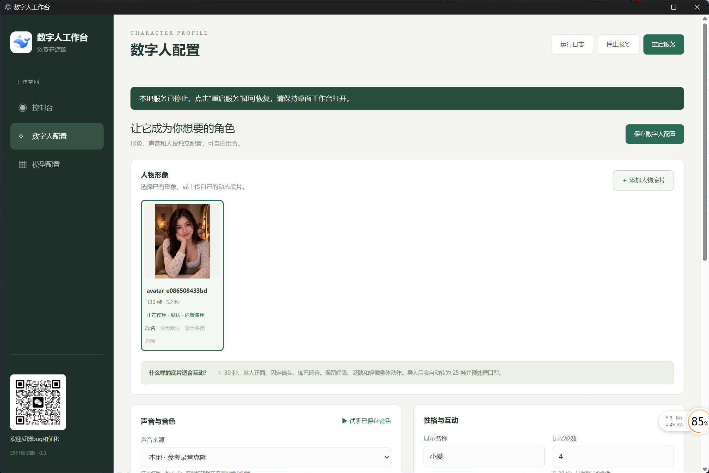
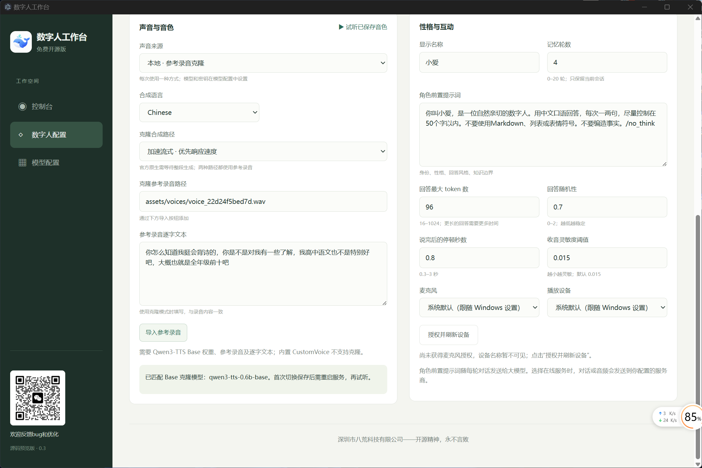
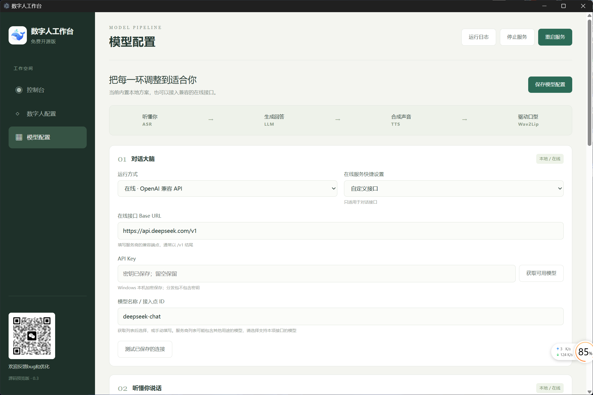

# 八荒实时数字人 · Bahuang-LiveAvatar


支持 Windows 本机运行的实时互动数字人工作台。像打视频电话一样，与数字人进行中文语音或文字对话，自由配置形象、声音、角色性格和本地／在线模型。

**免费开源版｜中文界面｜Windows 便携运行｜源码可修改**

[GitHub 源码](https://github.com/1213109176kgy-png/Bahuang-LiveAvatar) · [Gitee 源码](https://gitee.com/kugou8/Bahuang-LiveAvatar)

[百度网盘下载完整包](https://pan.baidu.com/s/1-7I4bplakJf1rqQxR1qSuw?pwd=2tza)（提取码 `2tza`） · [使用说明](docs/Windows便携版使用说明.md) · [开发说明](docs/开发说明.md) · [第三方许可](THIRD_PARTY_NOTICES.md)

## 功能

- 视频通话：一键拨打、至少 3 秒拨号动画、连接画面和开启麦克风、通话计时、挂断、全屏。
- 实时互动：语音识别、回答生成、声音合成、实时口型；文字输入、聊天记录、清空和打断。
- 人物管理：导入动态底片，自动预处理；选择、改名、删除，设置默认和备用形象。
- 声音与人设：本地预设试听、Base 参考录音克隆、在线音色、角色提示词和记忆轮数。
- 模型配置：LLM、ASR、TTS 分别选本地或兼容在线接口，支持模型列表获取、连接检测和本地模型导入。
- 口型引擎：默认 Wav2Lip256；MuseTalk 1.5 是需要额外权重和人物预处理的实验选项。

当前没有集成直播弹幕、礼物或一键推流。身体动作来自人物底片，口型引擎不会凭空生成全身动作。

## 免费下载完整免安装版

**[百度网盘下载 Windows 完整整合包](https://pan.baidu.com/s/1-7I4bplakJf1rqQxR1qSuw?pwd=2tza) · 提取码：`2tza`**

分享文件夹名为“我的开源项目”，请下载数字人项目的 **`LiveGirl-Windows-0.3.1.zip`**（约 14.9GB）。这是单个完整 ZIP，不需要合并分卷。

完整包包含运行环境、Qwen3 本地对话模型、Faster Whisper、Qwen3-TTS 预设与 Base 克隆模型、Wav2Lip256、MuseTalk 1.5 及配套权重，以及“小爱”人物底片。默认使用本地模型、预设音色和 Wav2Lip，无需填写在线密钥即可开始体验。

1. 下载完整 ZIP，**解压整个文件夹**；不要在压缩包内运行，也不要只移动 EXE。
2. 双击 **数字人工作台.exe**，等待顶部对话模型、数字人画面和语音服务就绪。首次加载需要时间。
3. 点击画面中的 **视频通话**，允许麦克风访问，3 秒拨打动画结束后开始交流；也可以输入文字发送。
4. 在“数字人配置”调整形象、音色和角色性格，在“模型配置”选择本地或在线模型。修改模型后按提示重启服务。
5. 点击挂断结束通话；右上角可停止或重启服务。浏览器打开工作台时，请保持桌面程序运行。退出桌面程序会关闭由它启动的后台服务。

支持 Windows 10/11 64 位，需要兼容的 NVIDIA 显卡驱动。无需另装 Python、Node、CUDA Toolkit 或 WSL。本机验证配置为 RTX 4060 Laptop 8GB；其他电脑的速度与可用模型受显存和算力影响。在线服务需要自己的接口与密钥；克隆需要自己的参考录音。ComfyUI/Wan 等外部底片制作工具不包含在运行包内。

完整包已做重新解压启动、本地对话、声音输出、实时画面和停止/重启测试；不包含开发者的 API 密钥、私人录音或聊天记录。附带第三方模型不等于获得任意商业使用授权，请遵守各模型、人物与声音的许可。

项目目前**停止持续迭代**，保留源码和现有整合包供免费体验、学习和自行修改。口型与真人仍有差距，不承诺真人效果或在任意电脑上达到实时速度。

### GitHub 旧版分卷

[GitHub Releases](https://github.com/1213109176kgy-png/Bahuang-LiveAvatar/releases/latest) 仍保留 v0.3.0 分卷发布，它与百度网盘 v0.3.1 完整包不同：旧版需要合并分卷，且未附带 Wav2Lip256 权重，首次运行需按提示自行导入。希望直接解压体验的用户请优先下载上面的网盘完整包。

## 效果视频与界面截图

以下为开发测试阶段的实际截图和原始录屏。录屏保留现场声音与测试画面，当前完整整合包版本为 v0.3.1。

### 视频 1：工作台互动录屏（约 32 秒）

[](docs/media/demo-01.mp4)

[打开或下载视频 1（MP4，含声音）](docs/media/demo-01.mp4)

### 视频 2：全屏通话录屏（约 65 秒）

[](docs/media/demo-02.mp4)

[打开或下载视频 2（MP4，含声音）](docs/media/demo-02.mp4)

点击视频封面或下方链接即可进入视频文件；若平台未提供在线播放，可下载 MP4 后观看。

### 界面截图

**控制台：视频通话入口**



**实时通话：人物画面与对话记录**



**人物形象：上传、改名、默认与备用底片**



**声音与人设：录音克隆、角色提示词和收音参数**



**模型配置：本地与在线接口**



## 技术路线

```text
麦克风 → VAD / Faster Whisper → 本地 Qwen3 或在线 LLM
       → Qwen3-TTS 或在线 TTS → LiveTalking / Wav2Lip256 → WebRTC
```

| 模块 | 默认／可选方案 |
|---|---|
| 对话大脑 | llama.cpp + Qwen3；DeepSeek、豆包等兼容接口 |
| 听懂语音 | Faster Whisper；兼容在线转写 |
| 生成声音 | Qwen3-TTS CustomVoice / Base；兼容在线 TTS |
| 说话口型 | Wav2Lip256；MuseTalk 1.5 实验选项 |
| 人物底片 | 用户导入；可在外部 ComfyUI 等工具制作 |
| 工作台 | 中文页面、配置管理、Electron 启动和语音连接层 |

验证硬件为 **RTX 4060 Laptop 8GB**。Wav2Lip 网页画面可达约 25 帧/秒；MuseTalk 1.5 说话阶段约 15–17 帧/秒，未达到本机实时目标。实际速度、等待时间和画质受硬件、声音模式及底片影响。

## 源码开发

仓库不包含运行时、巨型权重、个人 API Key、参考录音或聊天日志。建议先运行整合包再修改源码。

```powershell
git clone https://github.com/1213109176kgy-png/Bahuang-LiveAvatar.git
cd Bahuang-LiveAvatar
Copy-Item config/local.example.json config/local.json
```

源码 `app/` 对应整合包 `app/`，`desktop/` 对应包内 `resources/app/`。环境准备和更新方法见 [开发说明](docs/开发说明.md)。

## 已知限制与隐私

- 托腮、遮挡、露齿、转头和人脸裁切都会影响口型效果，不承诺达到真人画质。
- 打断会清空播放并丢弃旧回答，正在执行的 GPU 算子需运行结束。
- 在线兼容性取决于实际接口，文字和音频会发送到用户选择的服务商，费用由该服务商决定。
- 服务默认监听本机；API Key 用 Windows DPAPI 加密。详见 [SECURITY.md](SECURITY.md)。

## 开源许可与致谢

自有代码采用 [Apache-2.0](LICENSE)。LiveTalking、Qwen3-TTS、Faster Whisper、llama.cpp、MuseTalk 等保留原始作者和许可证，详见 [THIRD_PARTY_NOTICES.md](THIRD_PARTY_NOTICES.md)。代码许可不替代模型、人物、音色或第三方素材授权。

感谢各上游项目。欢迎提交 Issue、优化建议和 Pull Request。

## 作者与反馈

作者：**老K**  
公司：**深圳市八荒科技有限公司**

欢迎扫码交流使用体验、反馈 bug 和优化建议。


**深圳市八荒科技有限公司——开源精神，永不言败**
